### Hi, I'm Black Cat 🐈‍⬛

A tinkerer at heart — gadgets, operating systems, terminals, AI.
If it has a computer inside, I want to take it apart.

I love version updates. Every iteration feels like a rebirth.

